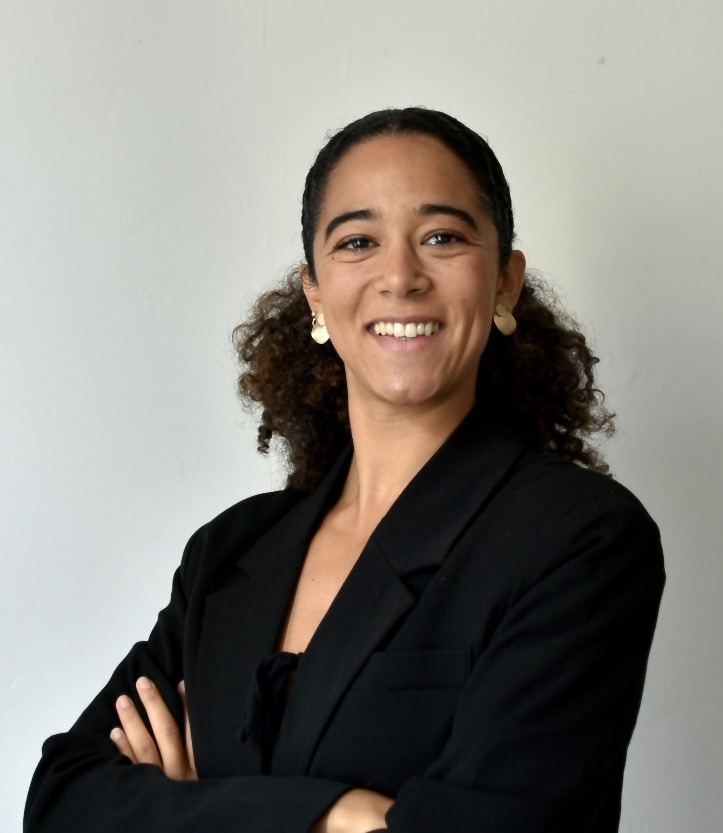

---
title: "Hello there!"
toc: false
page-layout: full
---

::: {.about-hero}

::: {.about-intro}

::: {.about-photo}

:::

::: {.about-text}

A LITTLE ABOUT ME

# I'm Olivia.

I'm a researcher with a PhD in genetics and epigenetics, and a particular interest in epidemiology and population health. 

In other words, I have spent a lot of time trying to understand why people are different, why some things affect our health more than others, 
and what thousands of data points can (and cannot) tell us about it.

*Spoiler: correlation doesn't always mean causation.*

:::

:::

:::

::: {.about-section}

## A little more about what I do

I've worked with large population cohorts, observational studies and plenty of datasets. 
Enough to know that behind every statistically significant result, there's always a much more interesting question.

And sometimes, a very complicated explanation.

:::

::: {.about-section}

## So, why *Population Matters*?

Because I think good research deserves good communication.

Not just prettier graphs or fewer technical words, but explanations of what the evidence actually tells us, including its uncertainties and limitations.

That's what interests me most: connecting the people we study with the people we communicate science to.

Population-based science. People-focused communication.

:::

::: {.about-section .about-connect}

## Let's connect

I'd love to hear about you.

Let's talk (and less p-values).

[Find me on LinkedIn](www.linkedin.com/in/olivia-castellini-pérez-phd-856231128){.text-link}

:::
