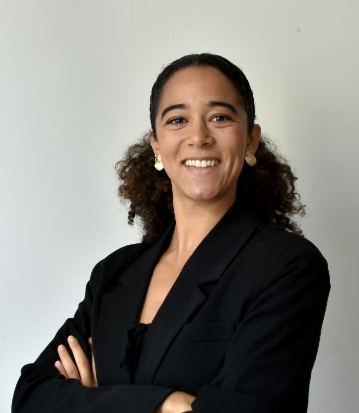

---
title: "¡Hola!"
toc: false
page-layout: full
lang: es
---

::: {.about-hero}

::: {.about-intro}

::: {.about-photo}

:::

::: {.about-text}

UN POCO SOBRE MÍ

# Soy Olivia.

Soy investigadora, doctora en Genética y Epigenética, e ineresada por la epidemiología y la salud poblacional.

En otras palabras, he pasado mucho tiempo intentando entender por qué somos diferentes, por qué algunas cosas afectan más que otras a nuestra salud y qué pueden contarnos miles de datos sobre todo ello (y qué no).

*Spoiler: correlación no siempre implica causalidad.*

:::

:::

:::

::: {.about-section}

## Un poco más sobre mi investigación

A lo largo de mi trayectoria he trabajado con grandes cohortes poblacionales, estudios observacionales y un buen número de bases de datos. 
Las suficientes para saber que detrás de cada resultado estadísticamente significativo suele esconderse una pregunta mucho más interesante.

Y, a veces, una explicación bastante complicada.

:::

::: {.about-section}

## Y entonces, ¿por qué *Las poblaciones importan*?

Creo que la ciencia es mucho más que obtener resultados o publicar artículos. 

Es conseguir que esos resultados tengan sentido, es saber cómo comunicamos la ciencia, quién está representada en la investigación y 
cómo podemos hacer que todo esto sea accesible e inclusivo.

Este intenta reunir todos esos intereses: ciencia en poblaciones. Comunicación para las personas.

:::

::: {.about-section .about-connect}

## Conectemos

Me encantaría saber de ti.

Hablemos (y dejemos los P-valores para otro momento).

[Encuéntrame en LinkedIn](www.linkedin.com/in/olivia-castellini-pérez-phd-856231128){.text-link}

:::
