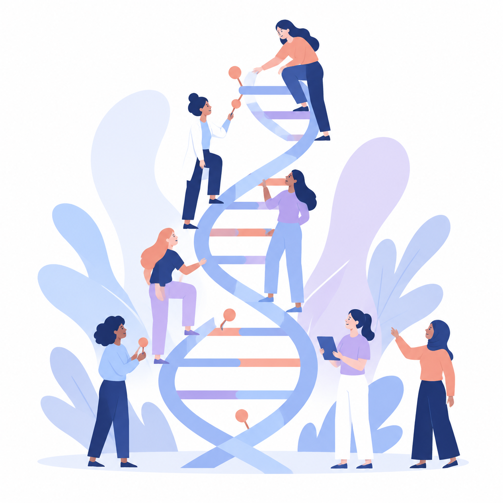

---
page-layout: full
toc: false
lang: es
---

::: {.hero-home}

::: {.hero-content}

EPIGENÉTICA · EPIDEMIOLOGÍA · COMUNICACIÓN CIENTÍFICA

# Ciencia en poblaciones. Comunicación para las personas.

Tendiendo puentes entre la investigación epidemiológica y la comunicación científica.
Combino mi experiencia en estudios poblacionales, genética y epidemiología con 
la comunicación científica para transformar resultados complejos sobre salud en información clara, 
accesible y relevante para diferentes públicos.

[Explora mi trabajo](stories.qmd){.hero-button}

:::
:::

::: {.home-section}

LEE Y DESCUBRE

## Blog

Serie de Blogs sobre investigación real, preguntas y/o debates alrededor de la epidemiología y el estudio de datos poblacionales. 

:::

::: {.home-section}

:::: {.series-grid}

::::: {.series-card}

[{.series-image}](stories.qmd)

:::::: {.series-content}

SERIE 01 · EPIGENÉTICA

### Tu ADN no determina tu destino

¿Qué puede contarnos la epigenética sobre nuestra salud,
nuestras experiencias y la biología que nos hace humanos?

[Explora la serie →](stories.qmd){.text-link}

::::::

:::::

::::

:::

::: {.home-section .research-section}

MÁS ALLÁ DE LAS HISTORIAS

## Investigación y datos

Detrás de cada historia científica hay preguntas, datos y descubrimientos.

Explora mis proyectos de investigación en epigenética, epidemiología y salud poblacional.

[Explora mis proyectos →](projects.qmd){.text-link}

:::

