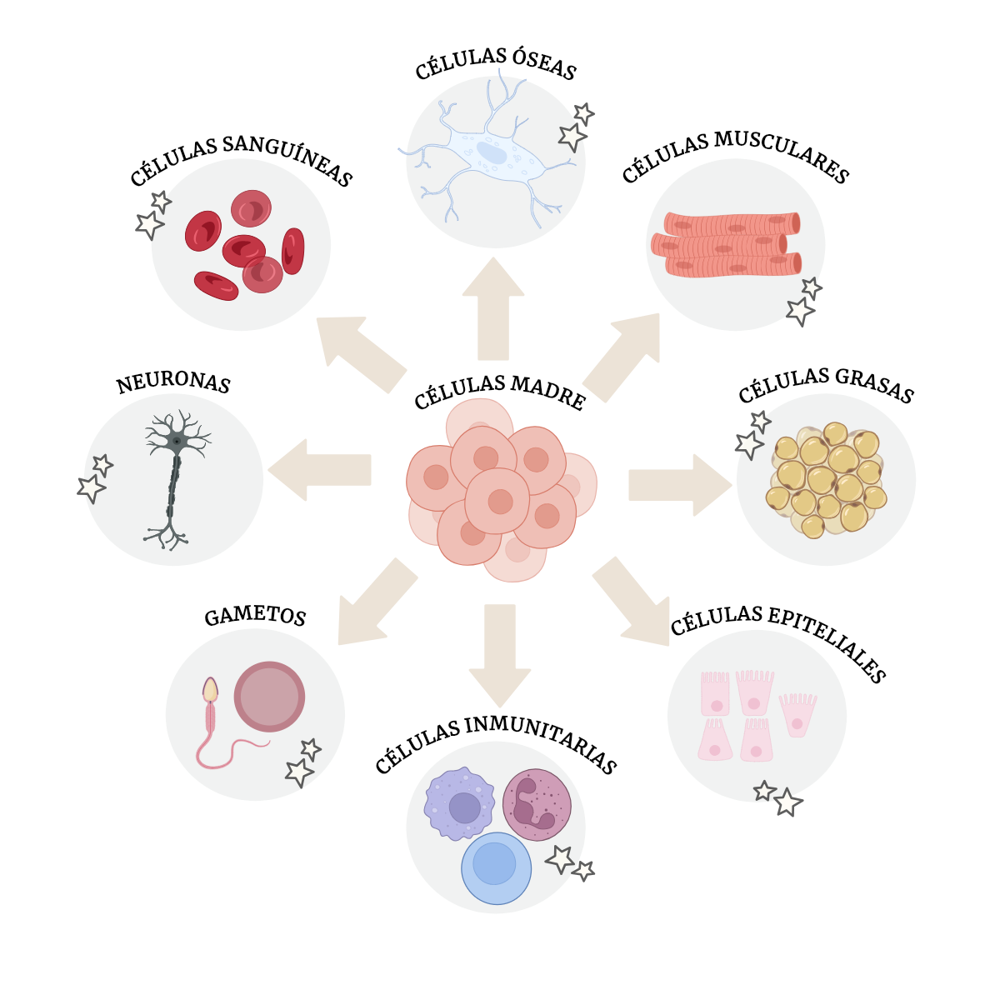
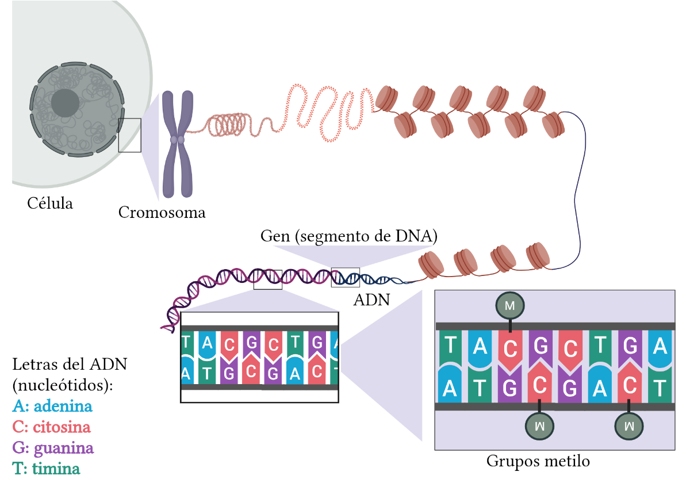
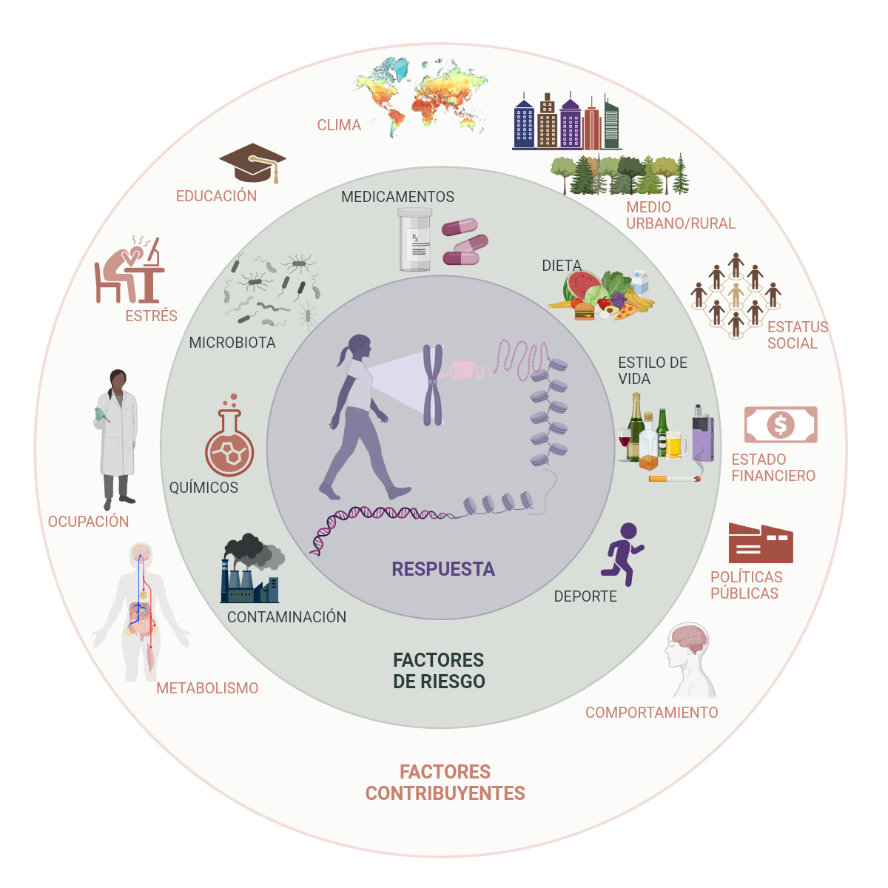

::: {.blog-collaboration}

::: {.blog-collaboration-logo}

  
  

:::

::: {.blog-collaboration-text}
**Originariamente publicado en colaboración con el Instituto de Genética y Cancer de la Universidad de Edimburgo.**

[Lee el artículo original en inglés](https://blogs.ed.ac.uk/institute-genetics-cancer/2026/11/09/you-are-more-than-your-dna/)
:::

:::

---

<!-- TEXT-->

*Somos más de lo que nos dicta el ADN*. ¿Pero qué quiere decir realmente eso?
Alguna vez te has preguntado que, si casi todas las células de nuestro cuerpo tienen el mismo material genético, ¿cómo es posible que una se pueda convertir en una neurona y otra en una célula cardíaca?

Básicamente todas nuestras células tienen la misma secuencia de ADN, salvo algunas excepciones como los glóbulos rojos, que no tienen ADN, entre otras. Entonces, cómo puede ser que las células musculares se contraigan, las inmunitarias nos defiendan de patógenos, las células de la piel actúen como barrera natura y las neuronas sean capaces de transmitir impulsos nerviosos para poner en acción a nuestro cuerpo. 

{width=85% fig-align="center"}

La respuesta parece simple, que tengan el mismo ADN no quiere decir que todas estén usando la misma información. 

**El ADN no es un libro de instrucciones**

Siempre nos han contado que el ADN lleva las instrucciones para que podamos funcionar. Por supuesto, hay algo de verdad en esto, sí que contiene la información que necesitamos para producir proteínas y/o moléculas que nos permiten sobrevivir. Sin embargo, no todas las células leen la misma información de esta secuencia de “instrucciones”. Existe una analogía mejor, si nos imaginamos que es una biblioteca, las células tienen acceso a todos los libros, pero no las neuronas tienen unas preferencias y las células musculares otras. Por tanto, ¿cómo saben qué información tienen que usar?

Los sistemas que regulan estos procesos funcionan desde el desarrollo de un individuo y mantienen la identidad de las células con el tiempo. También permiten que las células respondan ante ambientes cambiantes. Entre estos mecanismos regulatorios encontramos la fascinante área de la epigenética. 

**Bienvenida al mundo de la epigenética (epi para las amigas)**

La palabra epigénetica proviene del griego, siendo epi arriba o sobre algo. De repente pareciera algo misterioso que acecha sobre la superficie al ADN, pero no es para tanto. El epigenoma se entiende como las modificaciones del ADN sin que modifiquen su secuencia, que participan en su estructura y el uso del mismo. Una de las modificaciones más estudiadas es la metilación del ADN. 

Como nos han enseñado infinitas veces, el ADN es una secuencia de letras químicas: A, T, C y G. En sitios específicos de esta larga secuencia, especialmente en las Cs, se pueden unir unas marcas químicas llamadas grupos metilo. Muchas veces, estas Cs con sus grupos metilo van seguidas de la letra G y estos lugares se conocen como sitios CpG.

{width=85% fig-align="center"}

En algunas ocasiones, la metilación del ADN puede afectar a la regulación de la expresión de genes o incluso llevar al silenciamiento de algunos de ellos. Pero que ocurra una cosa u otra depende del lugar del genoma en el que se adhieran o las células que estén implicadas. 
A parte de la metilación, existen otras modificaciones epigéneticas que regulan cómo de accesible está la secuencia del ADN para su lectura. 

Todo esto sugiere que nuestro entendimiento de lo que significa el ADN debe de cambiar ligeramente. 

**Los genes no son el destino. Pero tampoco lo es el epigenoma**

Cualquiera que haya visto titulares clamando que la meditación, el trauma, o una dieta especial, puede *“reprogramar tus genes”*, ha sido introducido al mundo de la epigenética de manera popular. 
Por supuesto, llama la atención cuanto menos. 
El ADN es fijo, no cambia, pero el epigenoma sí se adapta. “Si cambias tu actitud entonces puedes cambiar tu epigenoma y tu destino”, por desgracia nada en nuestro funcionamiento biológico interno es tan fácil. 

Sí, es cierto que las marcas epigenéticas cambian con el tiempo. Hay evidencia de que el envejecimiento, enfermedades, o factores ambientales dan lugar a alteraciones en la metilación del ADN. Pero esto no quiere decir que cada experiencia en tu vida, o cada ciudad contaminada que visites van a dejar marcas, o que se vayan a traducir en algo clínico. 

En otras palabras, nuestro destino de desarrollar o no una patología no está por completo dentro de nuestro control si tomamos decisiones “correctas”. Este puede ser el aspecto más importante a la hora de comunicar sobre la epigenética, no hace falta añadirle ansiedad adicional al ya de por sí complejo funcionamiento de nuestro cuerpo. 

**Nuestra biología no funciona de manera aislada al resto del mundo**

Cuando en ciencia se habla del ambiente, muchas veces nos referimos a la contaminación del aire, a fumar, a las dietas o a exposiciones a químicos nocivos. Pero, el ser humano interactúa a lo largo de su vida con muchas más cosas. 
Crecemos en contextos familiares diferentes, en barrios y culturas diferentes. Nuestra existencia y experiencias se ven afectadas por todos estos ambientes y sus estructuras sociales. 

{width=85% fig-align="center"}

En mi identidad como mujer de una familia de origen mixto, toma doble relevancia cómo se abordan las diferencias biológicas en investigación y lo fácil que puede llegar a ser confundir una diferencia observada entre dos poblaciones con una explicación de por qué existe esa diferencia. 
Dos individuos pueden expuestos a diferentes niveles de contaminación, a diferencias en la alimentación, con un acceso desigual a atención sanitaria y experimentando diferentes tipos de estrés crónico. Y esto puede afectar a determinados procesos biológicos también influidos por cambios epigenéticos. 

Por tanto, ¿qué conclusiones pueden sacar la investigación cuando se observan diferencias en la metilación del ADN entre diferentes individuos?
¿A qué se deben estas diferencias? ¿Son ambientales, genéticas, por composición celular o por una combinación?
Normalmente, no es tan fácil saberlo. Aquí es donde podemos conectar la epigenética con preguntas más allá de lo que nos pase internamente. 

**Entonces, ¿somos más que nuestro ADN?**

Creo que llegadas a este punto podemos concluir que sí. Nuestro genoma tiene nuestras instrucciones, pero su uso responde y se adapta al entorno.
La epigenética forma parte de nuestra historia y nos ayuda a comprender cómo cambiamos a lo largo del desarrollo, el envejecimiento y la enfermedad. Pero no es una explicación mágica para todo aquello que nuestros genes no pueden explicar, ni tampoco una prueba de que cada experiencia deje una huella permanente.
Para mí, la belleza de la epigenética no está en que *nos diga quiénes somos, sino en que nos ayuda a explorar cómo llegamos a ser quienes somos.*

Y esto nos lleva a otra pregunta: **¿Puede el mundo que nos rodea dejar huellas medibles en nuestro epigenoma?**

*Ahí es donde continúa nuestra historia.*

## Notas:

*La imágenes están creadas usando BioRender*

