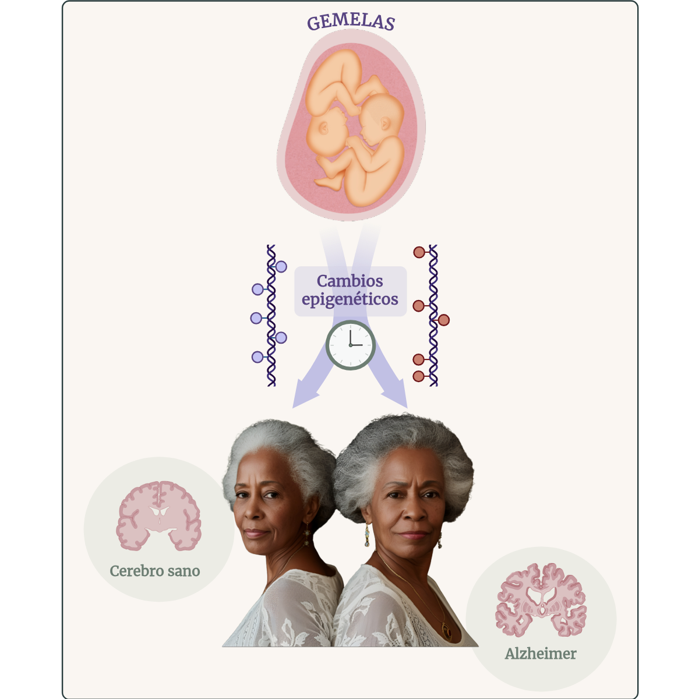
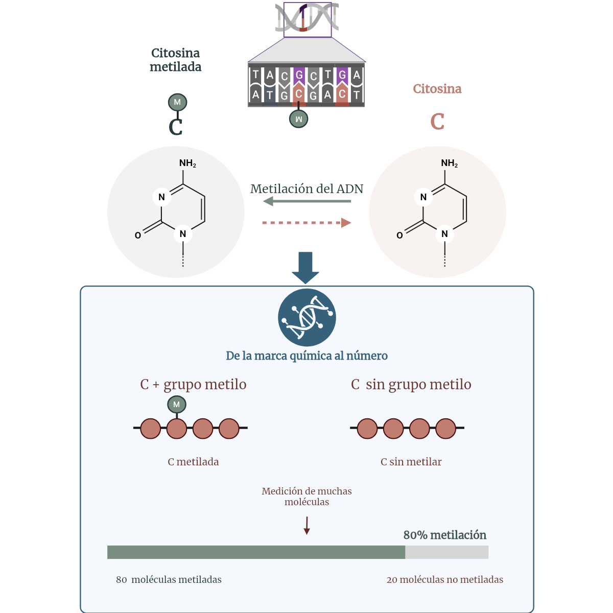
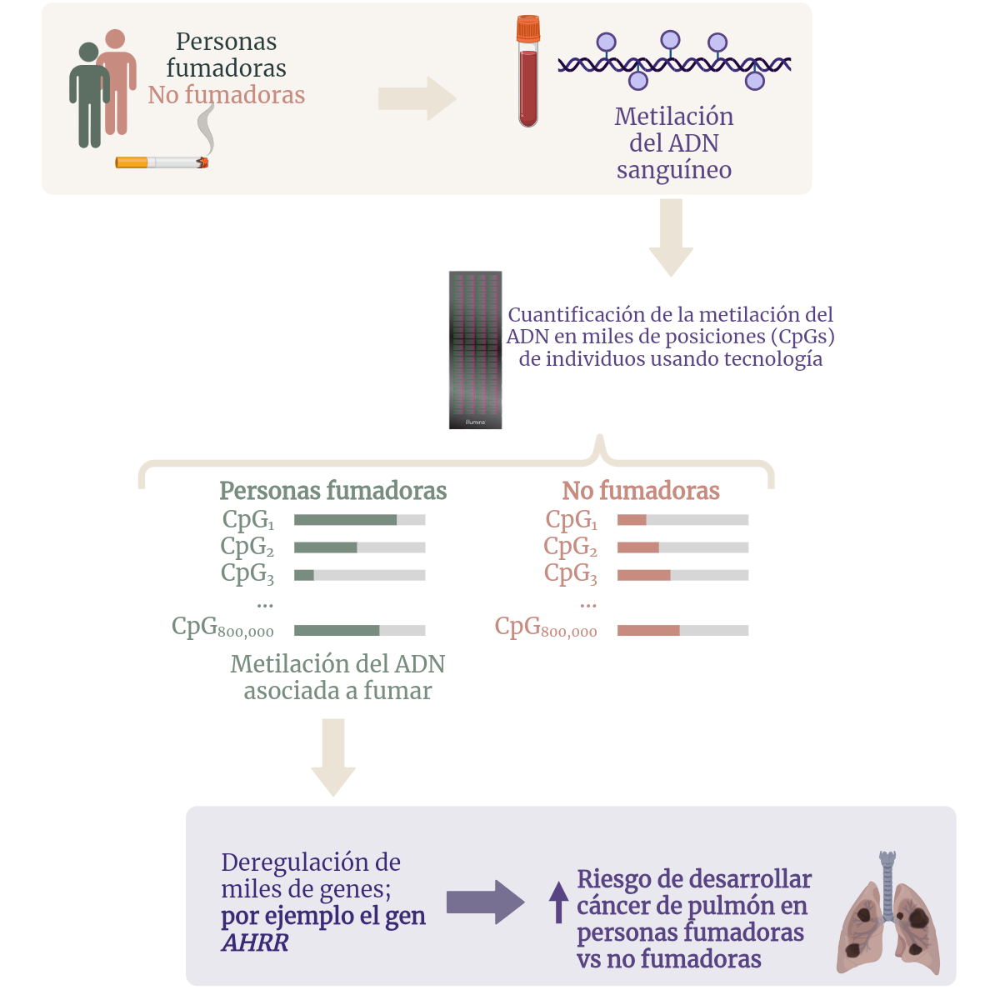

::: {.blog-collaboration}

::: {.blog-collaboration-logo}

  
  

:::

::: {.blog-collaboration-text}
**Originariamente publicado en colaboración con el Instituto de Genética y Cancer de la Universidad de Edimburgo.**

[Lee el artículo original en inglés](https://blogs.ed.ac.uk/institute-genetics-cancer/2026/11/16/can-the-world-that-surround-us-get-under-our-skin/)
:::

:::

---

<!-- TEXT-->

Imagina dos gemelas que fueron separadas al nacer. Una crece en un ambiente poco contaminado, con acceso a una alimentación saludable y estabilidad económica y sanitaria. Otra vive en una ciudad muy contaminada y con acceso más limitado a recursos sociales. 
Su ADN es el mismo, pero la interacción con el ambiente es diferente. ¿Cómo se reflejan estas diferencias en su cuerpo? Y más interesante todavía, ¿se pueden medir?

**Mismo ADN pero dos historias muy diferentes**

Los estudios en gemelos se llevan usando en investigación desde el siglo XIX. Y como a menudo, todo aquello que ha sido atravesado por la historia, no siempre es para una buena finalidad. La figura de gemelos, se ha utilizado desde mucho antes de la ciencia moderna, incluso en la mitología y se les ha tratado tanto de héroes como de monstruos. Pero para no alejarnos de lo que nos concierne en este capítulo, podéis leer más en el ensayo [“A history of twins in science”](https://press.princeton.edu/ideas/a-history-of-twins-in-science?srsltid=AYCX9vKASoYoI7epF96_wFZhqtvWg4zvPQ3p1mR5C8qEJz56HCx2JQNT) por William Viney publicado en Princeton University Press en 2024. 

El primer estudio con gemelos de la ciencia moderna data de los años 70, donde el británico eugenista, Francis Galton, afirmó en sus conclusiones que la genética prevalece al ambiente, entrando en el debate del que a lo mejor has escuchado hablar de la *herencia frente al ambiente* muy usado en epidemiología. A partir de entonces y entrando en estudios más recientes, investigadores han tenido que desligarse de estas afirmaciones peligrosas que a lo largo de la historia se han usado para justificar la deshumanización. Pero te explico como son estos estudios hoy en día y por qué son tan relevantes. 

Estas personas nacen con el mismo material genético, por eso al estudiarlas, se puede investigar cómo el ambiente o las experiencias de vida contribuyen a la salud, al riesgo de padecer enfermedad, al envejecimiento u otros aspectos. 

Y una vez más entra en juego la epigenética. 

Si seguimos con el debate de la *herencia frente al ambiente*, en 2005, Mario Fraga y compañía estudiaron alrededor de 40 personas gemelas con edades desde los 3 a los 74 años. Descubrieron que a medida que las parejas envejecían, sus marcas epigenéticas se iban diferenciando. Esto se podía traducir en que una de las personas de la pareja gemela podría desarrollar una enfermedad mientras que la otra no. También se observaron que las diferencias epigenéticas eran mayores cuanto más tiempo pasaran haciendo sus vidas de manera independiente. 

{width=85% fig-align="center"}

Dicho esto, no hay que precipitarse a concluir que ciertas experiencias se traducen en diferencias biológicas específicas. Una vez más no es tan fácil distinguir qué causa qué. 

A parte de los estudios con gemelos, existen otras maneras de estudiar el ambiente en los organismos. Por ejemplo, si se estudian a grupos poblaciones lo suficientemente grandes y se comparan sus marcas epigenéticas teniendo en cuenta diferentes informaciones particulares sobre su vida como la edad, estilos de vida, registros de enfermedades, etc, se pueden identificar patrones epigenéticos relacionados con esos aspectos. 

Hasta ahora, ya sabemos que todo lo que hacemos y vivimos en nuestras vidas y sociedades tienen un impacto en nuestra salud y desarrollo, pero esto no es nuevo. Por supuesto fumar va a ser malo para la salud, pero, ¿cómo podemos en ciencia medir estás marcas epigenéticas?

**Leyendo e interpretando las marcas epigenéticas en investigación** 

Si recuerdas el [blog](../epigenetics-part-1/index.qmd) anterior, la metilación del ADN son marcas químicas que se unen a la secuencia del ADN, concretamente en las citosinas (o letras Cs) y que muchas veces estas Cs van seguidas de una G (CpGs). Esto se traduce en que en localizaciones específicas del ADN la C puede o no llevar un grupo metilo: **presencia o ausencia**.

En la investigación de este campo se han desarrollado tecnologías que son capaces de medir estos grupos a lo largo de todo el genoma. Pero, ¿cómo podemos pasar de algo que parece estar o no estar a un número que se pueda cuantificar y estudiar?

Primero hay que extraer la muestra de donde procede el ADN. Normalmente sangre, aunque se usan otros tejidos, por ejemplo, saliva. Sin embargo, hay que tener en cuenta que la sangre no es un líquido sin más, contiene muchas células diferentes, así que cuando estudiamos la metilación a partir del ADN extraído de la sangre, estamos estudiando la metilación de miles de células. Y cada una tiene diferencialmente sus marcas.

Por tanto, lo que estudiamos es la media del nivel de metilación de todas las moléculas de ADN que están presentes en nuestra sangre. Para hacerlo más simple, imagina que, en la misma posición del genoma, en 100 moléculas diferentes de ADN, 80 de esas 100 tienen un grupo metilo en la C y 20 no. El resultado: en esa posición hay un 80% de metilación. 

{width=85% fig-align="center"}

Ahora, en lugar de presencia o ausencia, tenemos un número. Si nos vamos a un panorama general e imaginamos que medimos miles de estas posiciones y comparamos los niveles de metilación de todas esas en diferentes personas con y sin una enfermedad específica, podríamos identificar diferencias. Y ¿cómo se traduce todo esto a nivel clínico?

**Epigenética y enfermedad**

Tener o no tener un grupo metilo en el ADN provoca que la estructura del mismo se modifique, y que, por lo tanto, esa región pueda o no estar accesible para que se expresen genes. Por eso, la metilación del ADN puede influir en que nuestro organismo «lea» o no un gen localizado en esa región. En otras palabras, dependiendo de dónde se encuentre la metilación con respecto a los genes, esta puede facilitar o inhibir su expresión.
No hay mejor ejemplo para hablar de la relación entre la epigenética y las enfermedades que el tabaco y el cáncer de pulmón. Ya sabemos, y no es sorpresa para nadie, que fumar provoca alteraciones en la metilación del ADN en numerosas posiciones de nuestro genoma. Uno de los genes más estudiados es *AHRR*, que está implicado en cómo responde nuestro cuerpo a sustancias químicas ambientales. En las personas fumadoras se han observado niveles más bajos de metilación en determinadas posiciones de este gen, algo que también se ha asociado con el riesgo de desarrollar cáncer de pulmón.

{width=85% fig-align="center"}

Pero existe una buena noticia, y es que algunas de las alteraciones epigenéticas provocadas por el tabaco pueden revertirse parcialmente cuando una persona deja de fumar.
Obviamente este no es el único ejemplo. De hecho, se han observado cambios en la metilación del ADN en numerosas enfermedades, como el cáncer, las enfermedades autoinmunes, entre otras. En enfermedades autoinmunes como el lupus, por ejemplo, se ha observado una disminución general de la metilación del ADN en genes relacionados con el sistema inmunitario. Por otro lado, en algunos cánceres colorrectales se ha observado que existe un aumento de la metilación en genes cuya función es reparar los daños en el ADN.
Una vez más, esto no significa necesariamente que el cambio epigenético sea la causa de la enfermedad. También podría tratarse de un biomarcador de una exposición, como ocurre, por ejemplo, con el tabaco.

**Pero aquí viene lo interesante...**

Después de leer estos artículos, es fácil imaginar nuestro epigenoma como una especie de “diario” en el que quedan registrados todos los eventos de nuestra vida.
Por suerte, rara vez somos tan simples.

La metilación del ADN está influida por una compleja interacción de numerosos factores, como la genética, la edad, la composición celular, el ambiente e incluso procesos biológicos que no están directamente relacionados con nuestras experiencias.

Encontrar diferencias epigenéticas no es difícil; comprender lo que significan es otra historia. Aunque podamos analizar miles de estos cambios, saber si contribuyen al desarrollo de una enfermedad o si simplemente reflejan otros procesos no es fácil.

Y ahora se abre otra pregunta: si las enfermedades no afectan a todas las personas de la misma manera, **¿estamos incluyendo suficiente diversidad de personas en nuestros estudios?**

*Ahí es donde continúa nuestra historia.*

## Notas:

*La imágenes están creadas usando BioRender*

