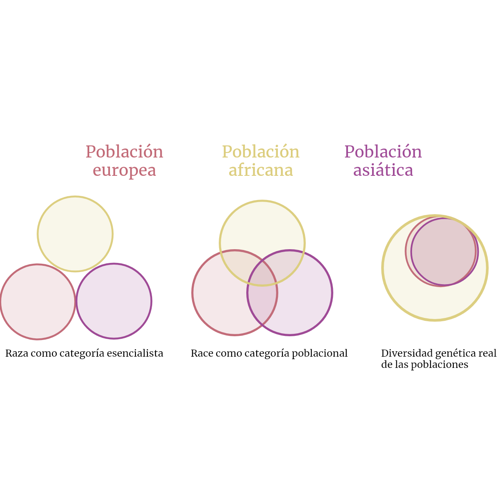
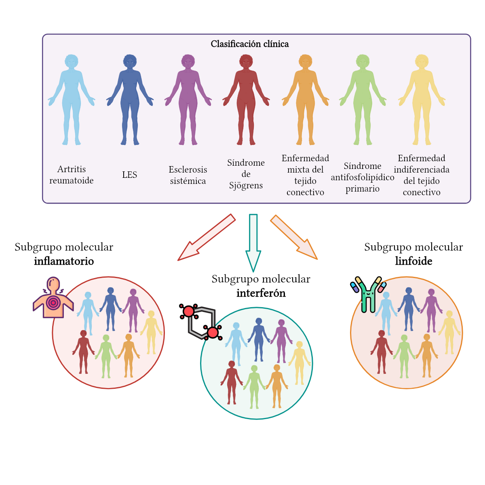
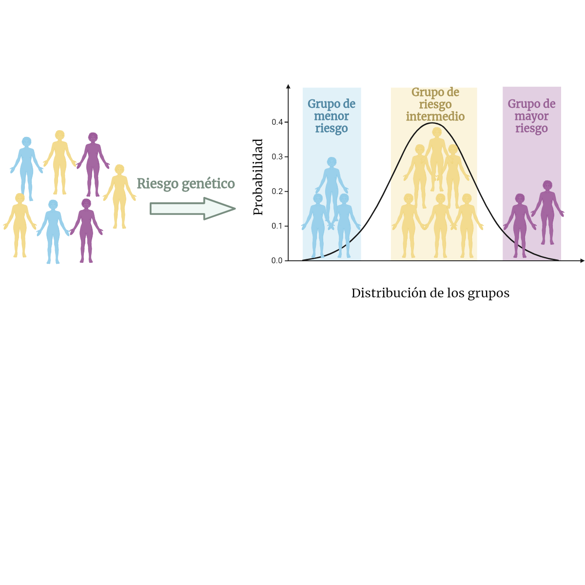

::: {.blog-collaboration}

::: {.blog-collaboration-logo}

  
  

:::

::: {.blog-collaboration-text}
**Originariamente publicado en colaboración con el Instituto de Genética y Cancer de la Universidad de Edimburgo.**

[Lee el artículo original en inglés](https://blogs.ed.ac.uk/institute-genetics-cancer/2026/11/24/whose-biology-are-we-studying/)
:::

:::

---

<!-- TEXT-->

Previamente hemos visto cómo se estudia la metilación en investigación y la importancia para entender nuestra salud y los procesos que pueden derivar en desarrollar una enfermedad. Sin embargo, llegamos a preguntarnos: si las enfermedades afectan de manera diferente a cada persona, *¿existe representación suficiente de la población para intentar entender estos procesos?*

Por ejemplo, supongamos que se llega a descubrir un biomarcador que permite predecir si una persona es susceptible a desarrollar una enfermedad. Después de estudiar a miles de personas se llega a la conclusión de que este biomarcador va a marcar una diferencia en las herramientas de diagnóstico y va a ser una innovación para poder implementarlo en la clínica. Parecen buenísimas noticias, pero y si ahora te digo que, esos miles de personas en las que se ha conllevado el estudio pertenecen a un mismo grupo que viven más o menos en lugares similares, del mismo sexo o con tendencia a un sexo concreto y de origen genético similar. *¿Te creerías que este biomarcador se pudiese usar globalmente?*

Pues esto pasa mucho más de lo que parece y entender su relevancia es primordial. Déjame ponerte un ejemplo más claro que ha sido muy importante durante mi trayectoria. 

## Lupus: ¿es una sola enfermedad?

Hablemos del lupus eritematoso sistémico. Esta es una enfermedad autoinmune en la que ocurre una desregulación del sistema inmunitario atacando a nuestras propias células de nuestro organismo. Afecta a muchos tejidos y órganos como pueden ser la piel, articulaciones o riñones, entre otras. Pero hay algo más importante a considerar y es que afecta mayoritariamente a mujeres; nueve de cada 10 personas que tienen la enfermedad son mujeres. 

Y no solo eso, además, también se ha visto que la prevalencia y severidad de la enfermedad depende del grupo poblacional que se esté estudiando. Un ejemplo de esto se refleja en un estudio reciente en Reino Unido, donde de 5,000 personas diagnosticadas con la enfermedad el 88% de ellas eran mujeres. Además, la mortalidad de la enfermedad se observó que era mayor en la población negra comparada con la blanca. 

Entonces, *¿cuál es la razón de observar estas diferencias? ¿son diferencias genéticas? ¿son hormonas sexuales? ¿es el ambiente? ¿son las diferencias de acceso al sistema de salud? ¿es una combinación de varias o de todas?*

Aquí está uno de los desafíos al estudiar enfermedades complejas, porque observar diferencias entre dos poblaciones no quiere decir que pertenecer a una u otra población es la causa de la misma. 

### ¿Cuánto explica la genética?
Cuando en investigación se observan estas diferencias entre poblaciones, pensar que es cosa de la genética es lo más directo. Y tiene todo el sentido del mundo, ya que existen muchas enfermedades con influencia genética como puede ser el lupus. 
Pero antes de continuar, tenemos que entrar en un debate importante: *¿cómo se define quién es de una población y no de otra a la hora de estudiar patrones genéticos?*

Ascendencia, etnicidad, ascendencia genética o raza. Todas parecen sinónimas, pero no lo son, de hecho, son muy dispares. Para empezar, las razas en el ser humano no existen como tal y menos para categorizar a los individuos. Por otro lado, es importante dejar claro que, aunque tengamos diferencias genéticas, estás no generan una división biológica entre nosotras. 

La ascendencia genética, por ejemplo, indica cómo nuestra genética tiene influencia de los flujos migratorios y la mezcla de poblaciones. El concepto de raza es simplemente un constructo social basada en la historia y no tiene explicación científica. Sin embargo, usar el término racial para clasificar a las personas sí que tiene implicaciones en sus vidas y en su salud. 

{width=85% fig-align="center"}

En 2023, la Academia Nacional de Ciencias, Ingeniería y Medicina en Estados Unidos (US National Acadmeies of Sciences, Engineering and Medicine) redactó un informe titulado [“El uso de descriptores poblacionales en la investigación genética y genómica: una nueva metodología para un campo que evoluciona” (Using Population Descriptors in Genetics and Genomics Research: A New Framework for an Evolving Field)](https://www.nationalacademies.org/read/26902). Este informe pone de manifiesto que la raza no es una manera adecuada ni científica de describir las diferencias genéticas entre individuos y que no debe de usarse a modo de sustituto de la ascendencia genética. 

Y podemos ir más allá. El informe destaca que incluso usar las clasificaciones comunes de ascendencia, así como las que se basan en clasificar según la procedencia geográfica, sigue creando una falsa sensación de que existen grupos genéticamente homogéneos de seres humanos.

Para mí el mensaje está claro: no solo necesitamos mejores términos sino que también tenemos que cambiar la manera de pensar sobre las poblaciones humanas. 

¿Entonces qué sugieren? Este informe concluye entre muchas otras cosas que en investigación se debe de usar una clasificación en función de la pregunta que se quiere resolver, pero que además siempre se tiene que tener en cuenta los factores ambientales, sociales y comunitarios y evitar en la medida de lo posible asunciones sobre la genética poblacional. A esto se suma que ya sabemos que la genética no actual sola, no quiere decir que lo que se descubra sobre el lupus en una población de una región se pueda extrapolar mundialmente. La manera individual en la que todo esto se estudia puede cambiar la interpretación de los resultados. 

### Mucho más allá que una simple etiqueta
En este punto, quizás ya no sorprende leer que agrupar a la gente en categorías no captura toda la diversidad. Seguro que has escuchado alguna vez la expresión de que el cáncer no es una única enfermedad y que hay tantos cánceres como pacientes. Pues esto no se aplica solo a esta patología, sino que se puede extender a muchas otras. Aquí introducimos el concepto de **heterogeneidad**. 

Si volvemos a los pacientes de lupus. Dos personas diagnosticadas con esta enfermedad ya hemos mencionado que presentan síntomas muy diferentes, y no solo eso sino que pueden responder o no al mismo tratamiento. Un paciente puede presentar erupciones cutáneas mientras otro presenta lesiones renales. Y por supuesto, esto no se trata solo de síntomas clínicos, detrás de cada proceso diferencial existe un proceso molecular diferente. 

Y una vez más, *¿podemos olvidarnos de las etiquetas y mirar más allá sin sesgos?*

En 2021, Barturen et al. publicaron un trabajo acerca de la heterogeneidad de las enfermedades autoinmunes donde se reclasifican 7 enfermedades autoinmunes, inlcuyendo lupus, artritis reumatoide, esclerosis sistémica y el síndrome de Sjögrens, en 3 grupos en relación con la enfermedad. Para ello tuvieron en cuenta diferentes procesos moleculares y usaron diferentes tipos de datos incluyendo metilación del ADN. Lo relevante de aquí es destacar que pacientes diagnosticados con lupus por ejemplo pueden pertenecer a grupos diferentes y por tanto ser mas similares molecularmente a pacientes de otras enfermedades que de la propia.  

{width=85% fig-align="center"}

En otras palabras, tener una misma condición no se traduce necesariamente en tener los mismos procesos moleculares y viceversa. Esto nos lleva a pensar cómo se puede hacer un diagnóstico fiable y cómo se diseñan los estudios si cada paciente es tan diferente. 

## ¿Tenemos todas las partes del puzle?

Vamos a situarnos de nuevo en las diferentes ascendencias genéticas, pero ahora añadimos una capa extra de heterogeneidad molecular y de las enfermedades complejas. *¿Cuánto podemos estar perdiendo si solo estudiamos a una parte de la población mundial?*

Existen muchas variantes genéticas1 que afectan a la susceptibilidad de una enfermedad, la regulación de la expresión de los genes e incluso los patrones de la metilación del ADN. Por ejemplo, durante mi doctorado publicamos un trabajo donde se observaba que los pacientes de lupus tienen marcas de metilación diferenciales entre los diferentes grupos moleculares de Barturen et al. Es decir, pacientes de un grupo tenían marcas diferentes a los de otro. Y más interesante todavía muchas de estas marcas estaban determinadas genéticamente y esta asociación con la genética también dependía del grupo molecular de los pacientes. 

## Investigación traslacional: ¿quién se beneficia de ello?

Y todo esto no solo se queda dentro de la academia y la investigación. Muchos de los estudios genéticos más relevantes a lo largo de la historia han sido con poblaciones concretas. Y esto tiene implicación en la traslación a la clínica. 

Un ejemplo pueden ser las puntuaciones de riesgo poligénico. Parece un término muy complicado, pero son simplemente herramientas que proporcionan información sobre posibles marcadores genéticos que cuantifican la predisposición individual a desarrollar una determinada enfermedad. Y lamentablemente muchos de estos marcadores se han identificado en europeos y se sabe que no se puede aplicar tan exitosamente a otros grupos. 

{width=85% fig-align="center"}

Y esto no solo se aplica a la genética, de la misma manera puede afectar a la epigenética, si alguien encontrase un marcador que haga que tu susceptibilidad a padecer una enfermedad sea mayor y esto solo se ha estudiado en un grupo específico de personas, ¿podemos estar seguras de que se puede aplicar a otras personas con otro contexto diferente?

Por todo esto, tener en cuenta la diversidad y la inclusión son importantes en genómica y en epidemiología. Pero no todo son malas noticias, esto poco a poco está cambiando y ya existen esfuerzos que buscan hacer una investigación más inclusiva

Para acabar como de costumbre, dejamos otra reflexión abierta para la siguiente. Algo que no he mencionado de la prevalencia de todas estas enfermedades complejas es que aumenta con la edad, y todos envejecemos. Biológicamente hablando, **¿envejecemos a la misma velocidad? ¿Cómo de importante es esto en el desarrollo de una enfermedad? ¿Y que nos puede decir la epigenética de ello?**

*Aquí es donde continúa la historia.*

##### Note
1.	*Cuando hablamos de variantes genéticas son pequeñas variaciones entre individuos en algunas de las letras de nuestro ADN. Todas tenemos diferentes variaciones, muchas veces son inofensivas pero otras pueden estar implicadas en enfermedades y aumentar por tanto tu predisposición a ellas.*

#### Referencias: 
Patel S, Russell MD, Bechman K, et al. The incidence, mortality and complications of systemic lupus erythematosus: a population-level cohort study from 2012 to 2023. Rheumatology (Oxford). 2026 May 5;65(5):keag206. doi: 10.1093/rheumatology/keag206. PMID: 42001214; PMCID: PMC13183668.
Feero, W.G., Steiner, R.D., Slavotinek, A. et al. Guidance on use of race, ethnicity, and geographic origin as proxies for genetic ancestry groups in biomedical publications. Nat Genet 56, 555–556 (2024). https://doi.org/10.1038/s41588-024-01708-8
Barturen G, Babaei S, Català-Moll F et al. Integrative Analysis Reveals a Molecular Stratification of Systemic Autoimmune Diseases. Arthritis Rheumatol. 2021 Jun;73(6):1073-1085. doi: 10.1002/art.41610. Epub 2021 Apr 26. PMID: 33497037.
Castellini-Pérez, O., Povedano, E., Barturen, G. et al. Molecular subtypes explain lupus epigenomic heterogeneity unveiling new regulatory genetic risk variants. npj Genom. Med. 9, 38 (2024). https://doi.org/10.1038/s41525-024-00420-0
Martin, A.R., Kanai, M., Kamatani, Y. et al. Clinical use of current polygenic risk scores may exacerbate health disparities. Nat Genet 51, 584–591 (2019). https://doi.org/10.1038/s41588-019-0379-x

