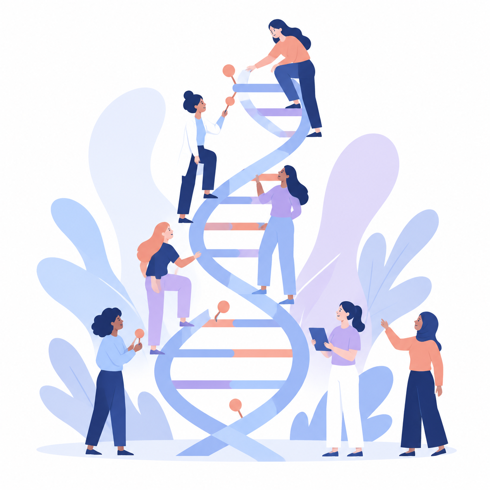

---
page-layout: full
toc: false
---

::: {.hero-home}

::: {.hero-content}

EPIGENETICS · EPIDEMIOLOGY · SCIENCE COMMUNICATION

# Population-based science. People-focused communication.

Bridging epidemiological research and scientific communication. 
I combine expertise in population-based research, genetics 
and epidemiology with scientific communication to make complex health findings clear, 
accessible and relevant to different audiences.

[See my work](stories.qmd){.hero-button}

:::

:::

:::: {.home-section}

READ & DISCOVER

## Blog

A collection of articles exploring published research, scientific questions 
and perspectives on epidemiology and population-based studies.

::::: {.series-grid}

:::::: {.series-card}

[{.series-image}](stories.qmd)

::::::: {.series-content}

SERIES 01 · EPIGENETICS

### Your DNA is not your fate

What can epigenetics tell us about our health,
our experiences and the biology that makes us human?

[Explore the series →](stories.qmd){.text-link}

:::::::

::::::

:::::

::::

::: {.home-section .research-section}

BEYOND THE STORIES

## Research & Data

Behind every scientific story, there are questions,
data and results.

Explore my research in epigenetics,
epidemiology and population health.

[Explore my projects](projects.qmd){.text-link}

:::
