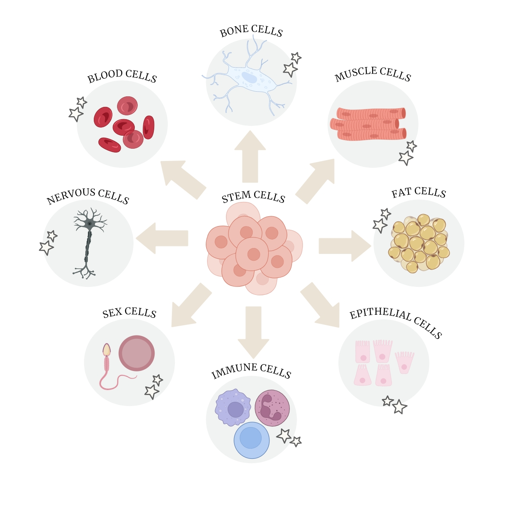
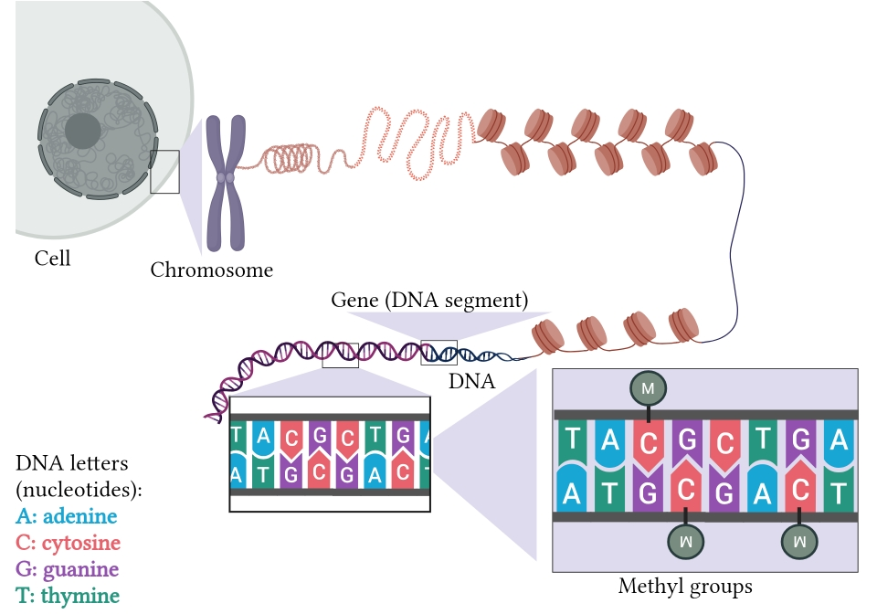
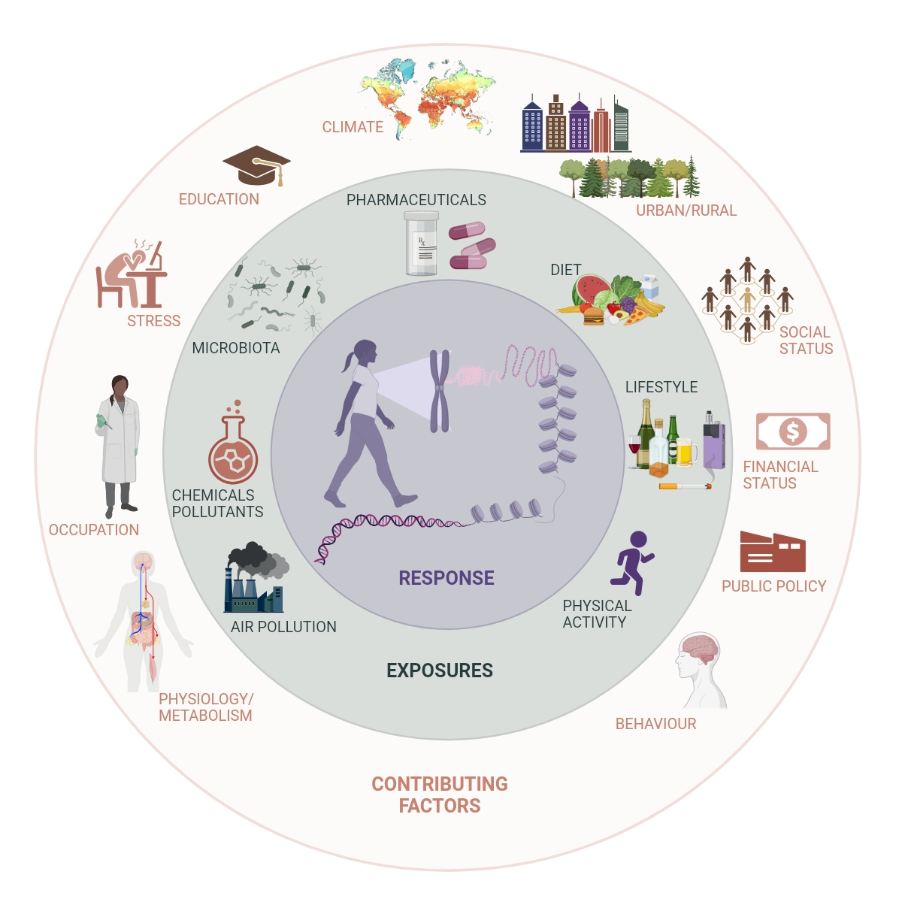

---
title: "Your DNA is not your fate"
subtitle: "Part one of a series of four blogs about epigenetics and health"
description: "You are more than your DNA"
date: "2026-11-09"
categories:
  - Epigenetics
  - Your DNA is not your fate
image: "images/cover.png"
toc: true
page-layout: article
---

::: {.blog-collaboration}

::: {.blog-collaboration-logo}

  
  

:::

::: {.blog-collaboration-text}
**Originally published in collaboration with the Institute of Genetics and Cancer, University of Edinburgh.**

[Read the original article](https://blogs.ed.ac.uk/institute-genetics-cancer/2026/11/09/you-are-more-than-your-dna/)
:::

:::

---

<!-- TEXT-->

*You are more than your DNA, but what does that actually mean?*
Have you ever wondered why if every cell of our body has the same DNA, one becomes a neuron while another becomes a heart cell?

All the cells in our body essentially carry the same DNA. There are a few exemptions though, such as red blood cells that do not have DNA at all. Then, how is it even possible that muscle cells contract, immune cells defend our body from infections, skin cells act as a barrier or brain cells transmit electrical pulses in order to control thoughts, movements and any other action that our body executes.

{width=85% fig-align="center"}

Initially the answer is simply having a gene written in the DNA is not the same as using that gene.

**The DNA is not a complete instruction book.**

We have always been told that DNA contains the instructions that tell our bodies how to act. There is some truth in that, don’t get me wrong. The DNA contains the information we need to produce the proteins and molecules that allow our cells to survive and do their jobs. However, not every cell reads and executes the whole book of instructions. There is an even better analogy – imagine that the DNA is a huge library. All our cells have access to the same library but neurons don’t need to read the same books as muscle cells. Therefore, the important questions are: what information is stored in the genome, which one is being used, in which cell and at what time?

Some of these regulatory systems are in place during development and serve to maintain the identity of the cell over time. Others allow the cells to respond to changing conditions. And amongst the molecular mechanisms involved is one that has become one of the most fascinating (and at times the most misunderstood) areas of modern biology: epigenetics.

**Enter the complicated epigenome world!**

The word epigenetics comes from the Greek epi, meaning above.

It almost seems like there is something mysterious or a secondary genetic code lurking above our genome, but there really is not. The epigenome can be thought of as any type of modification of the DNA and its related proteins involved in how the genome is organised and used.

One of the most commonly studied modifications is DNA methylation.

As we have been taught infinite times, DNA is a long sequence of four chemical letters: A, T, C and G. At particular sites, especially those in which a cytosine (C) is followed by a guanine (G), cells have the ability to add to the cytosine a small chemical group called a methyl group. Such sites are called CpG sites.

{width=85% fig-align="center"}

In certain cases, DNA methylation could affect the control of gene expression, even lead to gene silencing, but the effect is dependent on the location and cell type involved. Chemical modifications also include histones, which are proteins associated with the DNA. In addition, there are transcription factors and other proteins that regulate DNA accessibility.

Along with such proteins the identity of cells could be established and maintained. However, I find this area of biology especially exciting because…

Even if genomes are identical, the biological outcome may vary. It means our understanding of DNA should change.

**Genes aren’t the destiny. But neither is the epigenome.**
Anyone who has seen headlines asserting that meditation, trauma, or a special diet can “reprogramme your genes” has been introduced to epigenetics through the popular version.

It is a compelling story.

Your DNA might be static, but your epigenome is adaptable. “If you can modify your behaviour then you change your epigenome and your fate”. Sadly, biology isn’t that easy.

True, epigenetic patterns can change over time. There is evidence that ageing, development, illness and some environmental exposures result in alterations in DNA methylation. However, this doesn’t imply that each and every experience leaves a lasting mark on the molecules. Or that all methylation differences have any clinical relevance.

Nor does it imply that our biological fates are entirely within our control, if we only make the right decisions. This is perhaps one of the most essential points when communicating about epigenetics: the science is fascinating enough as it is. We don’t need to hype it up.

**Biology doesn’t exist in a vacuum**

When scientists discuss the environment, we often refer to air pollution, cigarette smoke, diet or chemical exposures. However, human beings do not interact with the world from a standpoint of isolated cells.

We develop within the context of families, neighbourhoods, societies. Our existence and experiences are influenced by the environments we live in and the social structures within them.

{width=85% fig-align="center"}

In my identity as a woman and from a mixed-heritage family, I find myself drawn towards studying how scientists study biological differences and how easy it is to confuse a difference between two populations as an explanation of the difference. Two individuals can have different exposure to pollution, nutrition, access to health care and chronic stress. The exposures may affect certain biological processes that can also be influenced by epigenetic changes.

What conclusions can researchers make when they observe some differences in the DNA methylation?

Was an environmental exposure a reason for the differences? Is there a genetic difference? Do the observed differences result from cellular composition of the samples? Was it due to the combination of multiple factors?

It is normally hard to figure out.

And this is where epigenetics connects to questions much bigger than molecules. If we want to understand human biological variation, we also need to understand the conditions in which that variation occurs.

**So, are we more than our DNA?**

Of course we are. Our genome provides the instructions for life, but how those instructions are used changes with cell development, response and adaptability. Epigenetics is part of that story, helping us understand how biology changes across development, ageing and disease. But it isn’t a magical explanation for everything our genes cannot explain, nor proof that every experience leaves a permanent mark.

**For me, the beauty of epigenetics isn’t that it tells us who we are, but that it helps us explore how we become who we are.**

And that leaves us with another question: **Can the world around us leave measurable traces in our epigenome? How can we measure them and what can they tell us about disease or any other healthy issues?**

*That’s where our story continues.*

## Notes:

*Images are self-made using BioRender*
