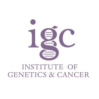

::: {.blog-collaboration}

::: {.blog-collaboration-logo}

  
  

:::

::: {.blog-collaboration-text}
**Originally published in collaboration with the Institute of Genetics and Cancer, University of Edinburgh.**

[Read the original article](https://blogs.ed.ac.uk/institute-genetics-cancer/2026/11/16/can-the-world-that-surround-us-get-under-our-skin/)
:::

:::

---

<!-- TEXT-->

Imagine two identical twins that were separated at birth. One grows up in a less polluted environment, where there is healthy food, a proper health care and some economic stability. And the other one is living in a very polluted city and experiencing lack of resources and uncertainty.
Their DNA is the same, but their interaction with the world is completely different. *Can these differences one day reflect in their biology? And even more interestingly, can these differences be somehow measured?*

**The same DNA but two very different stories**

Twin studies have been used in scientific research since the 19th century. And, as is often the case with things that have a long history, not always for the right reasons.
Long before modern science, twins had already fascinated humanity. They appeared in mythology, religion and folklore, sometimes portrayed as heroes or gods, and other times as monsters. But before we get too far away from what concerns us in this chapter, I’ll leave you with an interesting essay if you want to explore this further: A History of Twins in Science, by William Viney, published by Princeton University Press in 2024.
One of the earliest modern scientific studies of twins dates back to the 1870s, when Francis Galton, a British scientist and eugenicist, used twins to investigate whether heredity or environment had a greater influence on human characteristics. His conclusions strongly favoured genetics, introducing what you may have heard described as the **nature versus nurture** debate, a question that remains central to genetics, epidemiology, and many other research fields.
But there’s a darker side to this history. Galton’s work was closely connected to eugenics, and ideas about inherited human differences were later used to justify discrimination, exclusion, and even dehumanisation. More recently, twins researchers have had to confront this legacy and rethink not only how twin studies are conducted, but also how their findings are interpreted.

So, *what do twin studies actually look like today, and why are they still so valuable?*
Identical twins have nearly the same genetic material, so by studying them, researchers can explore how our environment and life experiences contribute to the differences in regard to their health, risk of diseases, ageing and other biology aspects.
That’s when epigenetics comes into play once again.

Continuing with the nature vs nurture debate, in 2005, Mario Fraga and colleagues studied around 40 identical twins aged from 3 to 74 years old. It has been discovered that younger twins have similar epigenetic characteristics, however, aged twins have more differences in epigenetic modifications. This means that as time passes hypothetically one twin could develop a disease while the other don’t. Differences were also linked to the amount of time they have spent apart.

{width=85% fig-align="center"}

That said, this does not mean that specific life experiences lead exactly to those differences. These epigenetic patterns can change through other biological processes as well and knowing which one is influencing is one of the challenges for researchers.
Obviously, there are other ways of studying the influence of the environment on the organism, not only with twins. One could study people during their entire life span, comparing them under various environments or looking at the connection between the experience and the changes in DNA methylation.
So far, we know that everything can affects our biology and risk of diseases, this story is not new. Of course, smoking is bad for our health and it is linked to increasing the risk of developing lung cancer. So, how can we, as scientist, measure something as small as an epigenetic change?

**How do we read and interpret an epigenetic mark?**

If you remember from the first blog, DNA methylation marks are like tiny chemical marks attached to our DNA sequence. But remember, these marks aren’t attached just anywhere. DNA methylation usually occurs at cytosines (the letter C in our DNA), particularly when they’re followed by a G (CpG). This means that, at a particular position, the C in our DNA can either have this mark or not. *Presence or absence.*

Scientists have developed technologies that can measure these marks across the whole genome. So, how do we go from something that seems like a yes-or-no answer to a number that we can use in research?
The first step is to take samples, usually from blood, although there are new studies using saliva samples. However, blood is made up of a number of different cells, so that when we study the methylation of the DNA from blood, we’re studying the methylation of thousands of cells that don’t have the same marks.
Thus, this is what we study: the average methylation level across all the DNA molecules in our blood. Imagine that we look at the same position in 100 different molecules of DNA. There are 80 of them with the epigenetic mark and 20 without. The result would be that we found 80% of methylation for that place. Instead of a yes-or-no answer, we now have a quantitative measurement.

{width=85% fig-align="center"}

Now imagine measuring thousands of these positions and comparing their methylation levels between people with and without a particular disease. This is how we can identify differences. And what do these differences mean for our biology?

**Epigenetics in disease**

Having a DNA methylation mark on your DNA can change its structure, making certain regions more or less accessible for gene expression. This is why DNA methylation can influence whether the body “reads” a gene located in that region or not.
In other words, depending on the location of methylation in relation to the genes, DNA methylation could facilitate or inhibit their expression.
There is no better example for discussing the connection between epigenetics and diseases than smoking and lung cancer. It is well known that smoking leads to the alterations of DNA methylation in many places within our genome. One of the most studied gene is *AHRR*, responsible for the response to environmental chemicals, in which low methylation level was observed among smokers that have also been associated with lung cancer risk.

{width=85% fig-align="center"}

The good news is that some of the epigenetic alterations caused by smoking can disappear partially when people quit smoking.

But smoking is not the only case where this can occur. Indeed, DNA methylation has been observed in a number of diseases such as cancer, autoimmune disorders and many other complex diseases. In autoimmune diseases like lupus, for example, it has been observed an overall decrease in DNA methylation in genes related to the body’s immune system. On the other hand, in colorectal cancers, increased methylation is observed in genes whose function is to repair DNA damage.

However, it does not mean that the epigenetic change causes the disease; it could be a biomarker of the exposure, for instance, a biomarker of smoking.

**But here comes the catch…**

After having read through these articles, one simply cannot help but visualize our epigenome as a biological journal, recording all of the events in our lives.
Thankfully, our biology is rarely that simple.
The DNA methylation process is affected by a complex interplay of numerous factors, such as genetics, age, cellular composition, environment, and even biological processes not directly associated with our life experience.
Finding the epigenetic variations isn’t hard; figuring out the implications is a totally different matter. While we may be able to analyse thousands of such changes, determining whether they have anything to do with disease or just represent the biology of our body is not an easy task.
But there’s another thing that needs to be considered: **if diseases are differently affected by each individual, are we including enough different subjects in our studies?**

*That’s where our story continues.*

## Notes:

*Images are self-made using BioRender*

