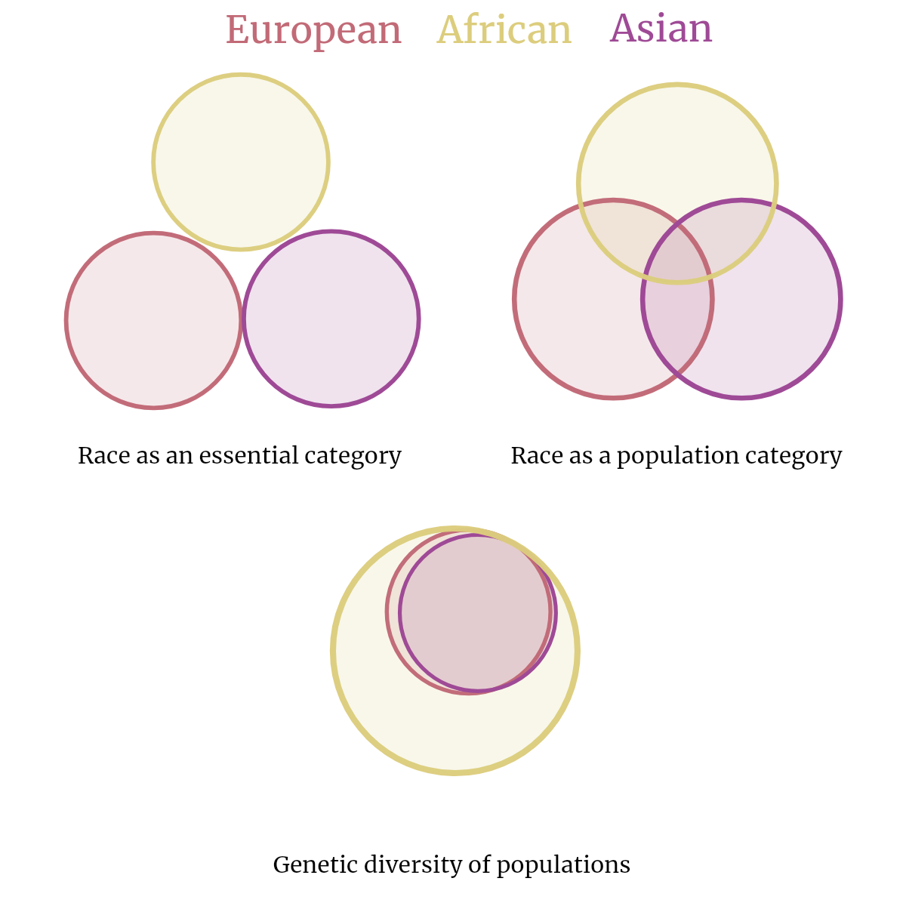
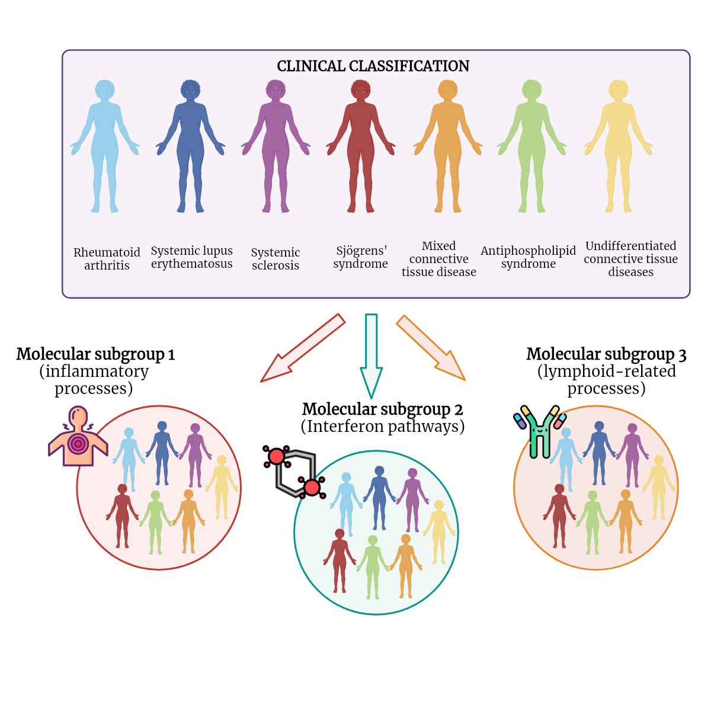
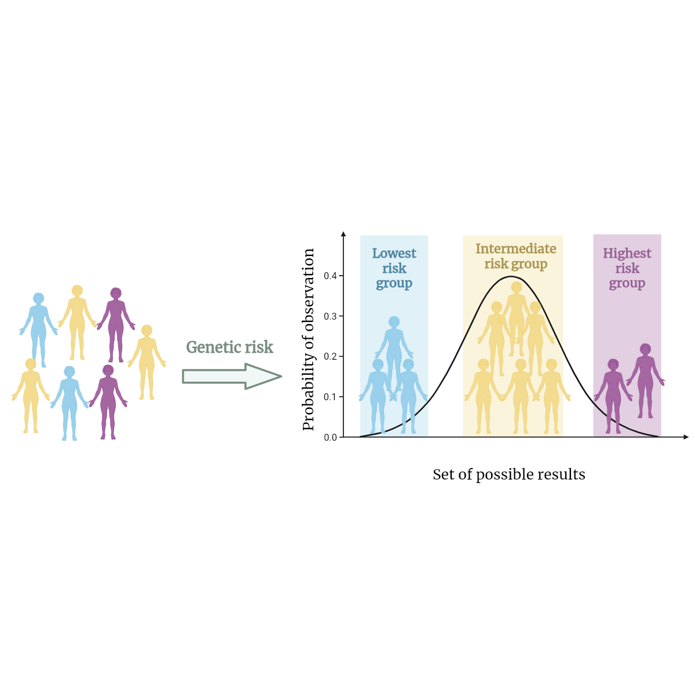

::: {.blog-collaboration}

::: {.blog-collaboration-logo}

  
  

:::

::: {.blog-collaboration-text}
**Originally published in collaboration with the Institute of Genetics and Cancer, University of Edinburgh.**

[Read the original article](https://blogs.ed.ac.uk/institute-genetics-cancer/2026/11/24/whose-biology-are-we-studying/)
:::

:::

---

<!-- TEXT-->

In the previous blog, we discussed ways by which researchers investigate DNA methylation and the importance of these differences for understanding health and disease.
However, we concluded with yet another question: With diseases affecting not all equally, do we study enough individuals to understand why?
For instance, suppose researchers discover a biomarker that would allow them to predict a person's susceptibility to developing certain diseases.
Then, they conduct their research on thousands of people and achieve encouraging results which make them believe that this biomarker could be used as a valuable diagnostic tool.

That's good news, right? But what if most of those thousands of people come from similar backgrounds, such as the same genetic ancestries, same environment, or same sex, for instance. *Would this finding work for everyone else?*

This might not always be the case. And in order to understand why this is relevant, let me put you another example that has been relevant during my research journey. 

## Lupus: is it just one disease?

Let’s talk about systemic lupus erythematosus. 
Lupus is an autoimmune disease characterized by the dysregulation of our immune system which leads to attacks against our own cells. The disease can be affecting multiple organs such as skin, joints, and kidneys. But there is one important thing to consider: almost nine out of ten people suffering from lupus are women. 
In addition, research shows that lupus is more prevalent in certain ethnic groups and the differences in incidence and severity are also present.

For instance, in the large epidemiological study of 5,000 people who were diagnosed with lupus in England, 88% of patients were women.The incidence and mortality rates of lupus were higher among black populations compare to white. But *why do we see these differences?*

Are they explained by genetics? Are they because of sex hormones? Environmental exposures? Differences in access to healthcare? A combination of all these?

This becomes one of the challenges, as a difference between two populations is not enough to know the reason for such difference.

### How much do genetics explain this?
When researchers observe such disparities between populations, one of the obvious explanations is that it could be due to genetics. And that makes a lot of sense, as there are many genetically influenced diseases, lupus is one of them. But first we should enter into a huge debate: **how are we defining populations in our societies and more importantly in research?**

Ancestry, ethnicity, genetic ancestry, or race. They all look like synonyms but they are actually very different terms. In fact, human races do not even exist as biological categories. It’s also important to note that whereas there are genetic differences among humans, these do not create a biological division among us. 

Genetic ancestry for instance, is an indication of our common genetic background influenced by migrations and admixtures between populations. Race is just a social category based on historical factors which are not scientific in nature. Nevertheless, the classification of a person belonging to a particular race have implications on how people live their lives and maintain their health. 

{width=85% fig-align="center"}

In 2023, the US National Academies of Sciences, Engineering, and Medicine issued a report under the title ["Using Population Descriptors in Genetics and Genomics Research: A New Framework for an Evolving Field"](https://www.nationalacademies.org/read/26902).This report stated that race is not a scientific way of describing genetic differences among people and should not serve as a substitute for genetic ancestry.

But it goes further than just that. This report also highlights that even common ancestry classifications, such as those based on continents, create a false impression that there exist genetically homogeneous groups of humans. 

For me the message is clear: **we need more than better labels; we should change the way we think about human populations.**  

The suggestions for researchers here are to choose the population classifications based on their specific scientific questions they are trying to answer, while considering environmental and social factors and involving communities, rather than perpetuating inaccurate assumptions about genetic classifications.

Thus, genetics don’t act on its own. Observing more severe lupus in some populations or subpopulation doesn’t mean that these findings can be extended worldwide. These differences could also reflect other exposures. Because how we define the populations we study, can influence how we interpret the results.

### More than just one label

Maybe it shouldn’t be surprising that grouping people into broad population categories does not entirely capture their diversity. Have you ever heard the expression that any cancer cannot be categorise in just one unique disease and that there are as many as there are cancer patients? And this is not just in cancer, in can be applied to many other complex diseases. This expression introduces an important concept in the complex diseases research: the **heterogeneity**

If we go back to lupus. Two people diagnosed with this disease can have very different manifestations and even respond in a very distinct way to the same treatment. Perhaps one patient mainly has skin rushes while another develops severe kidney issues. And of course, it is not only a matter of clinical differences, behind them there are molecular processes involved that are equally different. 
So, *can we forget about the labels once again and try to look beyond the names?*

In 2021, *Barturen* and colleagues published a very interesting work in which they reclassified patients with 7 different autoimmune diseases, including lupus, rheumatoid arthritis, systemic sclerosis and Sjögren’s syndrome into three disease-related, molecularly homogenous groups by looking at similar molecular processes among all individuals. But here is the relevant part: patients diagnosed with lupus could belong to different molecular groups and be more similar to a patient with another clinical diagnosis, such as rheumatoid arthritis than to another patient with lupus. 

{width=85% fig-align="center"}

In other words, having the same disease doesn’t directly translate into having the same molecular processes. And having different diseases does not imply different molecular mechanisms. 
This opens questions about how we diagnosed diseases and how we design studies or trials if patients are so different.

## Are we then seeing the whole picture? 

If we think about the genetic ancestry and the disease heterogeneity, how many biological differences we may overlook while studying a small part of humanity?

Many genetic variants^1^ can affect our susceptibility to disease, the regulation of gene expression and even the DNA methylation patterns. For instance, during my PhD, we published a study in which we observed that, in patients with lupus, DNA methylation changes differed across the molecular groups established by Barturen and colleagues’ work. Patients from one group showed very different methylation marks compared to patients from the other molecular groups. And more importantly, some of these DNA methylation changes were also associated with different genetic variants depending on the molecular group as well. 

However, these studies were included mainly European ancestry. It is known that some of these genetic variants appear to be more common in particular populations. So, including more diverse populations may increase our understanding of which genetic variants or other molecular modifications may be involved in complex diseases. 

## Research translation to healthcare: who benefits from it?

This is not a purely academic question. Large genetic studies have been dominated for decades by individuals of European genetic background. And this has implications when we try to apply our findings to health care.

One such application involves polygenic risk scores. These are tools which use the information provided by multiple genetic markers to quantify an individual’s genetic predisposition to develop a certain disease. Scientific literature shows that polygenic risk scores that were developed mainly on the basis of individuals of European ancestry usually perform worse on individuals of other genetic backgrounds.

{width=85% fig-align="center"}

Though these are genetic technologies, the same issue needs to be considered when developing epigenetic biomarkers. For instance, imagine finding out that some DNA methylation mark will help in predicting the development of lupus or identifying patients who are going to respond better to a certain treatment. Could you be sure that your finding will be useful in the case of patients whose genetic or environment were not completely reflected in the research?

That’s why diversity issues in genomics and epidemiology are not only about representation but also about clinical translation and utility.

But not everything is wrong and that's changing. We already have international research projects and efforts which try to include more heterogeneous populations in genomic and epidemiologic researches. Yet, in my opinion, there are many years of work to catch up on.
To finish, let's open another question in relation to heterogeneity and differences in our lives. Something that we haven’t mentioned before is that the prevalence of many of these diseases, e.g. cancer, autoimmune disease, increases with age. And we all get older. Biologically speaking, **do we age at the same rate? Is this important for the risk of developing a disease. And could our epigenome make us understand how?**

*That's where our story continues.*

#### Note: 
1. *When we talk about genetic variants these are variations in any of the letters of the DNA along the genome among individuals. We all have our own variations, sometimes these variants are harmless but other times they are disease-related and they indeed increase your risk of developing a particular disease.*

#### References: 
Patel S, Russell MD, Bechman K, et al. The incidence, mortality and complications of systemic lupus erythematosus: a population-level cohort study from 2012 to 2023. Rheumatology (Oxford). 2026 May 5;65(5):keag206. doi: 10.1093/rheumatology/keag206. PMID: 42001214; PMCID: PMC13183668.
Feero, W.G., Steiner, R.D., Slavotinek, A. et al. Guidance on use of race, ethnicity, and geographic origin as proxies for genetic ancestry groups in biomedical publications. Nat Genet 56, 555–556 (2024). https://doi.org/10.1038/s41588-024-01708-8
Barturen G, Babaei S, Català-Moll F et al. Integrative Analysis Reveals a Molecular Stratification of Systemic Autoimmune Diseases. Arthritis Rheumatol. 2021 Jun;73(6):1073-1085. doi: 10.1002/art.41610. Epub 2021 Apr 26. PMID: 33497037.
Castellini-Pérez, O., Povedano, E., Barturen, G. et al. Molecular subtypes explain lupus epigenomic heterogeneity unveiling new regulatory genetic risk variants. npj Genom. Med. 9, 38 (2024). https://doi.org/10.1038/s41525-024-00420-0
Martin, A.R., Kanai, M., Kamatani, Y. et al. Clinical use of current polygenic risk scores may exacerbate health disparities. Nat Genet 51, 584–591 (2019). https://doi.org/10.1038/s41588-019-0379-x
